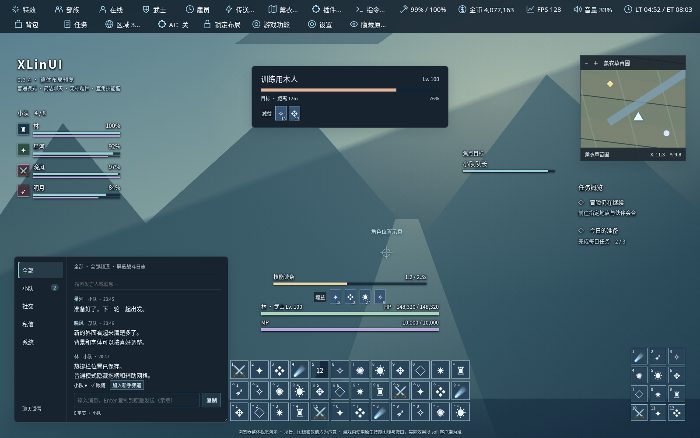

# XLinUI

给亲友用的 FF14 界面小改造。聊天、顶部栏和热键栏可以按自己的习惯调整，让常用信息更清楚，也保留原版的技能拖放和操作。



*这是界面示意图，游戏里的图标与效果以实际运行结果为准。*

## 安装

适用于 **国服 soil XIVLauncher / Dalamud API 15**，当前版本 **0.3.4**。

1. 打开 Dalamud 设置 → 实验性 → 自定义插件仓库。
2. 添加下面的地址，保存并刷新插件列表。
3. 搜索 **XLinUI**，点击安装。

```text
https://raw.githubusercontent.com/HanaSi0/XLinUI/main/pluginmaster.json
```

[手动下载](https://github.com/HanaSi0/XLinUI/releases/download/v0.3.4/XLinUI.zip) · [版本页面](https://github.com/HanaSi0/XLinUI/releases/tag/v0.3.4)

以前用本地开发路径加载过旧版的亲友，先停用旧插件、移除旧 DLL 路径，再安装这个版本。旧高版本不会自动降级。已经通过仓库安装的亲友，刷新列表后更新即可。

## 可以调整什么

- **聊天**：自定义分类、字号、宽窄和输入区；可隐藏原版聊天，也可选择显示“加入新手频道”小按钮。
- **顶部栏**：图标快捷入口，金币、装备状态、时间等信息靠右显示，每项都能自己开关。
- **热键栏**：支持普通 1–10 栏，独立移动和缩放；Shift 网格吸附，Ctrl 多选移动，保留原版技能拖入。
- **外观**：圆角或直角、颜色、透明度、图片模糊背景，以及从电脑导入图片和字体。
- **小地图**：方形地图、游戏标记、滚轮缩放和点击打开地图；资源未加载时保留原版。
- **战斗界面**：简洁生命／魔力、目标、读条与状态显示，各模块可单独开关；状态图标按原比例绘制，分为增益、减益和其他。

## 开始使用

输入 **`/xlinui`** 打开设置。加入频道或编辑热键栏时，先在模块设置里开启“游戏交互”。聊天发送暂用兼容模式：Enter 将指令复制，再粘贴到原版聊天发送。

热键栏 → **打开编辑模式**，所有调整放在二级菜单里。完成或关闭菜单后，拖柄与参考网格隐藏，布局保留。横竖排列、共享栏和键位继续通过原版设置；技能拖不进去时检查原版技能格锁定。

想暂时恢复界面，输入 **`/xlinui off`**；重新开启用 **`/xlinui on`**。部分游戏窗口仍使用原版，这个插件会继续根据亲友使用情况完善。

有问题或建议，可以直接告诉我，或[在这里留言](https://github.com/HanaSi0/XLinUI/issues)。

## 本次更新

- 频道接收筛选按附近、小队、私信、部队、通讯贝、系统和战斗等分组，可批量勾选、按名称或编号搜索。
- 快捷方案包括全部消息、玩家交流、小队与团队、私信、部队与通讯贝、系统与活动；应用会替换接收筛选及默认发送频道。
- 可单独屏蔽战斗刷屏，新增空分类不会接收全部消息。修改导入分类时保留未删除频道的 Chat Two 关系过滤。
- 聊天侧栏使用选中色条和独立未读徽标，长名称自动省略；顶部标签支持滚动。可开关筛选摘要与未读徽标。

继续保留本机图片模糊背景和 Chat Two 配置导入；默认开启时背景不透明。参考 [Chat Two 公开源码](https://github.com/Infiziert90/ChatTwo) 的配置结构，导入不修改原插件。

原生直接发送和共享纹理改写继续暂停。聊天 Enter 复制指令后粘贴到原版发送。
